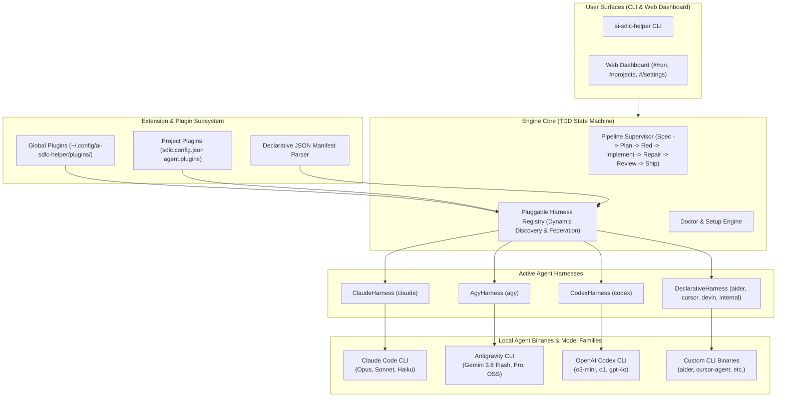
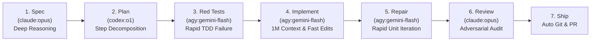

# Multi-Agent Harness Architecture & Setup/UI Re-design

**Role:** Principal Developer Platform Architect (Multi-Agent Harnesses & CLI Tool Runtimes)  
**Status:** Architectural Blueprint & Implementation Specification  
**Target:** Multi-agent runtime abstraction (`claude`, `agy`, `codex`), open plugin/extension architecture for any third-party or custom agent, unified cross-agent model federation, setup/doctor redesign, and Web UI federation.

---

## 1. Executive Summary & Paradigm Shift

`ai-sdlc-helper` previously coupled its 7-stage TDD pipeline (Spec &rarr; Plan &rarr; Red tests &rarr; Implement &rarr; Test repair &rarr; Review &rarr; Ship) directly to Anthropic's Claude Code CLI (`claude`).

This architecture transitions `ai-sdlc-helper` into an **open, extensible multi-agent orchestrator**. By decoupling pipeline execution behind an **`AgentHarness`** contract and an **Open Plugin Extension Architecture**, the system enables developers to:
1. Run the SDLC pipeline with **Anthropic Claude Code (`claude`)**, **Google Antigravity CLI (`agy`)**, **OpenAI Codex CLI (`codex`)**, or any third-party coding agent (e.g. Aider, Cursor CLI, Devin CLI, internal enterprise agents).
2. Add new coding agents dynamically via **ESM plugins** or **zero-code declarative JSON manifests** without touching or modifying the engine codebase.
3. Select models from multiple coding agent ecosystems (e.g. `gemini-3.8-flash-high`, `o3-mini`, `o1`, and `claude-opus-4-6`) within the same run or mapped per-stage.
4. Seamlessly onboard, register projects, and run health checks without being blocked if only one coding agent is installed.



---

## 2. Feature Parity & Verification Matrix (`claude` vs. `agy` vs. `codex`)

Empirical verification of local binaries on the target development system:
- `claude` (Anthropic Claude Code v2.1.312)
- `agy` (Google Antigravity CLI v1.4.10)
- `codex` (OpenAI Codex CLI v0.166.0)

All three CLIs natively support the essential primitives required by the 7-stage TDD pipeline:

| Pipeline Requirement | `claude` Native Feature | `agy` Native Feature | `codex` Native Feature | Compatibility & Adaptation Strategy |
| :--- | :--- | :--- | :--- | :--- |
| **1. Headless Execution** | `claude -p "<prompt>"` | `agy -p "<prompt>"` | `codex exec "<prompt>"` | **Standardized Invocation.** Non-interactive headless execution. Harness maps `-p` or `exec` subcommand cleanly. |
| **2. Autonomous Edit Mode** | `--permission-mode acceptEdits` | `--mode accept-edits` | `-s workspace-write --approve-for-me` | **Sandbox & Approval Mapping.** `HarnessInvocation.mode` sets the respective flags without prompting. |
| **3. Machine Output** | `--output-format json` | `--output-format json` | `--json` (JSONL events) or `-o <file>` | **Schema Translation.** Claude returns `{ result }`; Antigravity returns `{ response, denied_actions }`; Codex streams JSONL with `{ type: "message", content }`. Normalized via `harness.parseOutput()`. |
| **4. Reasoning Effort** | `--effort (low\|medium\|high\|max)` | `--effort (low\|medium\|high\|xhigh\|max)` | `-c model_reasoning_effort="high"` | **Config Translation.** Both flag-based (`--effort`) and TOML config override (`-c`) are handled transparently. |
| **5. Working Directory Root** | Process `cwd` | Process `cwd` | `-C, --cd <dir>` or process `cwd` | Direct flag or Node process option passed to child spawn. |
| **6. Read-Only Audits** | `--permission-mode bypass` | `--output-format json` (read stages) | `-s read-only --json` | Hard sandbox boundary for Spec, Test Audit, and Code Review stages. |
| **7. Permission Restrictions** | `--allowedTools Bash(cmd:*)` | `--settings '{"permissions":{...}}'` | Sandboxed shell + execpolicy `.rules` | Abstract permissions stored in `.sdlc/permissions.json` translated to runner-native syntax. |
| **8. Rate Limit Recovery** | `api_error === 'usage_limit_reached'` | Exit status & `d.status === "RATE_LIMITED"` | `event.error.code === 'rate_limit_exceeded'` | Normalized `rateLimitedUntil` timestamp triggers automatic exponential backoff. |

---

## 3. Core Engine Architecture: Pluggable Agent Harness & Registry

### 3.1 Type Contract (`src/pipeline/harness/types.ts`)

The architecture completely decouples the engine from hardcoded agent enums:

```typescript
export type BuiltinHarnessId = 'claude' | 'agy' | 'codex';
export type HarnessId = BuiltinHarnessId | (string & {});

export interface HarnessModel {
  id: string;              // e.g. "gemini-3.8-flash-high", "o3-mini", "opus"
  name: string;            // e.g. "Gemini 3.8 Flash (High)", "OpenAI o3-mini"
  harness: HarnessId;      // "agy" | "codex" | "claude" | "aider" | ...
  supportsEffort: boolean; // true
  defaultEffort?: 'low' | 'medium' | 'high' | 'xhigh' | 'max';
  description?: string;
}

export interface HarnessInvocation {
  command: string;                  // CLI binary name or absolute path
  args: string[];                   // Process CLI arguments
  env: Record<string, string>;       // Specific environment variables
  tempSettingsFile?: string;        // Optional temp config file
}

export interface HarnessResult {
  text: string;                     // Primary model output/response
  exitCode: number;                 // Process exit code
  denials: Array<{ tool: string; detail: string; rule: string }>;
  rateLimitedUntil?: Date | null;   // Rate limit backoff timestamp
  usage?: { inputTokens?: number; outputTokens?: number; totalTokens?: number };
  rawJson?: Record<string, unknown>;
}

export interface AgentHarness {
  readonly id: HarnessId;
  readonly name: string;
  readonly defaultBinary: string;

  detect(env?: NodeJS.ProcessEnv): Promise<HarnessDetection>;
  listModels(env?: NodeJS.ProcessEnv): Promise<HarnessModel[]>;
  compileStageArgs(opts: StageCompileOptions): HarnessInvocation;
  compileAuditArgs(opts: { prompt: string; model: string; effort?: string; cwd?: string }): HarnessInvocation;
  parseOutput(stdoutText: string, stderrText: string, cwd?: string): HarnessResult;
}
```

---

## 4. Open Extension & Plugin Architecture

To guarantee that **any new coding agent** can be integrated without modifying `ai-sdlc-helper` core code, the system provides two extensible integration mechanisms:

### 4.1 Programmatic TypeScript/ESM Plugins (`AgentHarnessPlugin`)

Complex agents requiring custom authentication tokens, daemon lifecycles, or streaming output transformations implement `AgentHarnessPlugin`:

```typescript
export interface AgentHarnessPlugin extends AgentHarness {
  readonly meta: {
    version: string;
    author?: string;
    description?: string;
    homepage?: string;
  };
  initialize?(context: { configDir: string; env: NodeJS.ProcessEnv }): Promise<void> | void;
}
```

Example custom plugin (`~/.config/ai-sdlc-helper/plugins/enterprise-agent.js`):
```javascript
export default {
  id: 'enterprise-agent',
  name: 'Internal Enterprise Coding Agent',
  defaultBinary: 'corp-ai',
  meta: { version: '1.2.0' },
  async detect(env) {
    return { installed: true, path: '/usr/local/bin/corp-ai' };
  },
  async listModels() {
    return [{ id: 'corp-large', name: 'Corporate Large (Fine-tuned)', harness: 'enterprise-agent', supportsEffort: false }];
  },
  compileStageArgs(opts) {
    return {
      command: 'corp-ai',
      args: ['run', '--task', opts.prompt, '--mode', opts.mode === 'acceptEdits' ? 'auto' : 'dry-run'],
      env: { CORP_AI_TOKEN: process.env.CORP_AI_TOKEN || '' },
    };
  },
  compileAuditArgs(opts) {
    return { command: 'corp-ai', args: ['audit', '--task', opts.prompt], env: {} };
  },
  parseOutput(stdout, stderr) {
    return { text: stdout.trim(), exitCode: 0, denials: [] };
  }
};
```

### 4.2 Zero-Code Declarative JSON Manifests (`DeclarativeHarnessManifest`)

For CLIs that follow standard command-line conventions, plugins can be authored as simple `.json` files without writing any code:

```json
{
  "$schema": "https://ai-sdlc-helper.dev/schemas/harness-v1.json",
  "schemaVersion": "1",
  "id": "aider",
  "name": "Aider AI Pair Programmer",
  "binary": "aider",
  "detection": {
    "versionArgs": ["--version"]
  },
  "models": [
    { "id": "deepseek-coder", "name": "DeepSeek Coder V2", "supportsEffort": false },
    { "id": "claude-3-7-sonnet", "name": "Claude 3.7 Sonnet (via OpenRouter)", "supportsEffort": true, "defaultEffort": "medium" }
  ],
  "flags": {
    "prompt": "--message",
    "modelFlag": "--model",
    "effortFlag": "--reasoning-effort",
    "acceptEditsFlag": "--yes --auto-commits",
    "bypassPermissionsFlag": "--yes",
    "outputFormatFlag": "--no-pretty"
  },
  "outputMapping": {
    "responseField": "response"
  }
}
```

### 4.3 Plugin Discovery Lifecycle

`HarnessRegistry` discovers and loads plugins at boot time through two complementary scopes:
1. **Global User Plugins:** Scanned from `~/.config/ai-sdlc-helper/plugins/*.json` and `*.js`/`*.mjs`.
2. **Project-Scoped Plugins:** Configured in `sdlc.config.json` under `agent.plugins`:
   ```json
   {
     "agent": {
       "plugins": [
         "./tools/sdlc/my-custom-harness.js",
         "@company/sdlc-harness-plugin"
       ]
     }
   }
   ```

---

## 5. Setup, Registration & Tooling Re-design

### 5.1 Redesigned `doctor` Health Check (`src/registry/doctor.ts`)

Previously, Doctor failed fatally if `claude` was missing:
```text
✗ claude CLI: the claude command is not on PATH
  fix: install Claude Code (npm install -g @anthropic-ai/claude-code)
```

**New Multi-Agent Doctor Behavior**:
1. Dynamically invokes `harnessRegistry.detectAll()` to discover all installed harnesses (`claude`, `agy`, `codex`, plus dynamic plugins).
2. **Dynamic Pass Criterion:**
   - If **at least one** harness is found and operational: **Pass (✔ Ready)**.
   - Summarizes all available agents:
     `✓ coding agents: claude (2.1.312), agy (1.4.10), codex (0.166.0)`.
3. If no coding agent is installed:
   - Clear failure summary: `"No supported coding agent found on PATH. Install any of: Claude Code (claude), Google Antigravity (agy), or OpenAI Codex (codex)."`.

### 5.2 Redesigned `ai-sdlc-helper add` Registration CLI

Interactive project registration detects all available agents on `$PATH` and presents a dynamic selection:
```text
Detected coding agents on PATH:
  1. claude (Anthropic Claude Code - Opus 4.6, Sonnet 4.6, Haiku 4.5)
  2. agy (Google Antigravity CLI - Gemini 3.8 Flash, Pro, OSS 120B)
  3. codex (OpenAI Codex CLI - o3-mini, o1, gpt-4o)

Select primary agent harness for this project [1/2/3, default: 1]:
```

Configuration in `sdlc.config.json`:
```json
{
  "agent": {
    "runner": "auto",
    "defaultHarness": "agy",
    "stageHarnesses": {
      "spec": "claude",
      "plan": "codex",
      "red-tests": "agy",
      "implement": "agy",
      "test-repair": "agy",
      "review": "claude"
    }
  }
}
```

Flags added to `ai-sdlc-helper add`:
- `--agent <id>`: Explicitly lock the primary harness (e.g. `add . --agent agy` or `add . --agent codex`).

---

## 6. Cross-Agent Model Selection & Stage Routing

### 6.1 Model Addressing & Namespacing

Models are federated and addressed with explicit harness namespaces:
- `claude:opus` &rarr; Claude Opus 4.6 executed via `claude`
- `agy:gemini-3.8-flash-high` &rarr; Gemini 3.8 Flash (High) executed via `agy`
- `codex:o3-mini` &rarr; OpenAI o3-mini executed via `codex`
- If no harness prefix is specified (e.g. `o3-mini`), the engine automatically routes to the harness that provides the model, falling back to the project's default runner.

### 6.2 Cost & Performance Hybrid Strategy

Different stages of the SDLC have distinct cognitive demands. Stage routing enables optimal cost, speed, and reasoning:



---

## 7. Web Dashboard UI Re-design

### 7.1 `Projects` Screen (`web/ui/src/Projects.tsx`)
- Displays an **Agent Ecosystem** banner at the top listing all detected local agents with live status badges:
  `Detected Coding Agents: [claude ✔ v2.1.312] [agy ✔ v1.4.10] [codex ✔ v0.166.0]`.
- In the "Add a project" card, an **Agent Harness** dropdown dynamically populates from `HarnessRegistry.list()`.

### 7.2 `Settings` Screen (`web/ui/src/Settings.tsx`)
- Adds an **Agent Runtime & Harnesses** configuration panel:
  - Default runner switcher (`auto`, `claude`, `agy`, `codex`, or installed plugin).
  - Active coding agents status with "Probe" buttons to verify API connectivity.
  - Per-stage default harness and model mappings.

### 7.3 `Run` Screen (`web/ui/src/Run.tsx`)
- In the Stage Rail (`STAGES.map`), the model selector groups options by harness dynamically:
  ```html
  <optgroup label="Anthropic Claude Code (claude)">
    <option value="claude:opus">Claude Opus 4.6</option>
    <option value="claude:sonnet">Claude Sonnet 4.6</option>
  </optgroup>
  <optgroup label="Google Antigravity (agy)">
    <option value="agy:gemini-3.8-flash-high">Gemini 3.8 Flash (High)</option>
    <option value="agy:gemini-3.8-pro">Gemini 3.8 Pro</option>
  </optgroup>
  <optgroup label="OpenAI Codex (codex)">
    <option value="codex:o3-mini">OpenAI o3-mini (High Effort)</option>
    <option value="codex:o1">OpenAI o1</option>
  </optgroup>
  ```
- Tooltips and badges indicate which local binary will execute each stage.

---

## 8. Implementation Roadmap

1. **Step 1: Harness Contract & Registry Core (Complete)**
   - `src/pipeline/harness/types.ts`: Pluggable types and plugin interfaces.
   - `src/pipeline/harness/claude.ts`: Claude Code CLI adapter.
   - `src/pipeline/harness/agy.ts`: Google Antigravity CLI adapter.
   - `src/pipeline/harness/codex.ts`: OpenAI Codex CLI adapter.
   - `src/pipeline/harness/declarative.ts`: Zero-code JSON manifest harness plugin adapter.
   - `src/pipeline/harness/registry.ts`: Dynamic plugin discovery and registry singleton.
   - `test/harness.test.ts`: 16/16 unit tests passing.

2. **Step 2: Engine Integration & Doctor Decoupling**
   - Update `src/pipeline/agent.ts` to execute via `AgentHarness`.
   - Update `src/registry/doctor.ts` to detect `claude`, `agy`, `codex`, and custom plugins dynamically.
   - Migrate `.claude/sdlc-permissions.json` to `.sdlc/permissions.json` with backward compatibility.

3. **Step 3: Registration CLI & Settings**
   - Update `src/cli/projects.ts` (`add` command) with `--agent` flag and interactive harness picker.
   - Update `src/config/settings.ts` schema with `agent.runner`, `agent.defaultHarness`, and `agent.plugins`.

4. **Step 4: Web UI Federation**
   - Update `Projects.tsx`, `Settings.tsx`, and `Run.tsx` with dynamic multi-agent dropdowns and harness badges.
