# Web UI redesign: stages rail, parallel reviewers, navigation

A redesign of the run screen's Stages block and the pages around it. It builds on the first canvas in
[../design/web-ui/](../design/web-ui/README.md).

Live canvas, with working popovers, model search and menu: https://claude.ai/artifact/4vXLcEFCwDWDJCERG8QiaJ

- `canvas/`: the design source. `canvas.json` places the boards; one `.dc.html` per screen. These are design
  components for the canvas, not app code.
- `screenshots/`: each board rendered at 2x, plus three open states.

## Why

The Stages block put each stage's agent, model and effort dropdowns, file count and skip control inside its
tile. Seven tiles filled the row, Resolve conflicts wrapped under Spec as an eighth cell, and a growing details
area pushed the Pull Request, Output, Environment and Agent rounds panels down the page.

A horizontally scrolling row was considered and kept only as the narrow-window fallback: it hides stages, so
the row no longer shows the whole run at a glance, and auto-scrolling to the running stage fights a user who has
scrolled away.

## The run screen

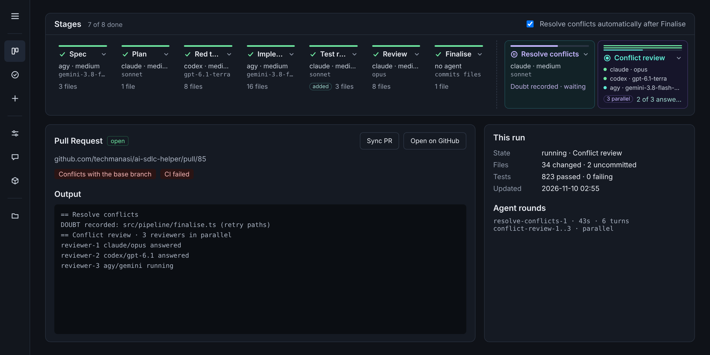

### Stage tiles

- One row, no scrolling at desktop width. Each tile shows a progress bar, a status icon, the name, the agent and
  effort, the model, and one status line (file count, live step and time, or "Not started").
- The block stays about 150 px tall, so the panels below keep their place.
- Clicking a tile opens a popover over the page with Agent, Model and Effort. It does not push content down.
- A running stage's popover shows its steps and a read-only, locked agent/model line. Settings cannot change
  under a running stage.
- Pipeline stages sit left of a dashed divider. Resolve conflicts sits right of it, as an after-PR stage.
- Conditional stages: before the run, Test repair and Resolve conflicts show as dashed tiles ("Only if Implement
  flags tests", "Only on PR conflicts") so they can be configured early. During a run, Test repair appears only
  when Implement claims test defects, tagged "added".
- When the PR conflicts, a Resolve conflicts button appears in the Stages header.

### Before the run

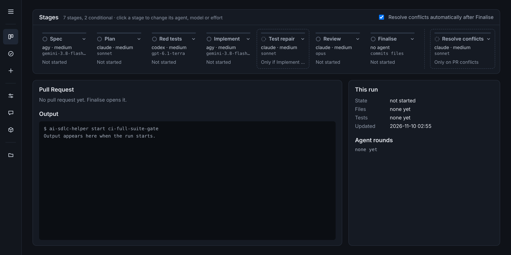

### Parallel reviewers when a stage records doubt

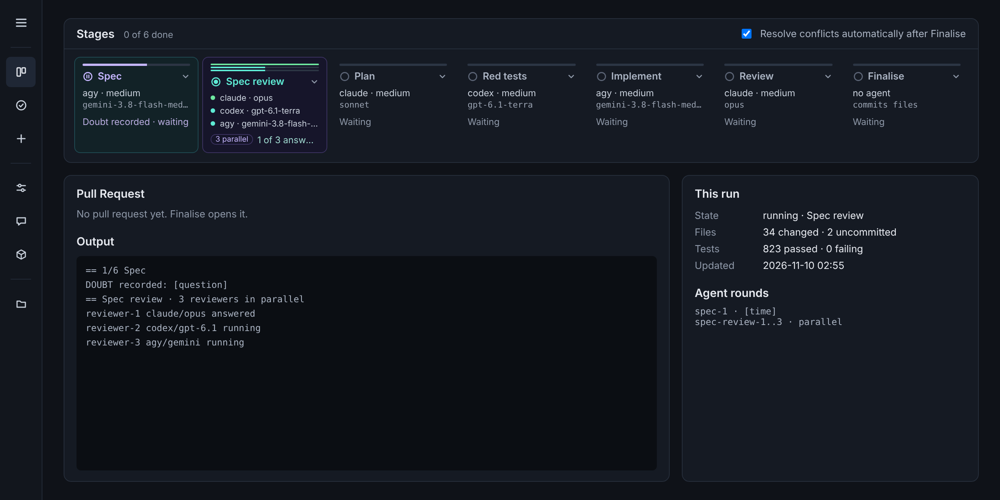

- When an agent records doubt, a reviewer stage is inserted right after it (Spec review, Conflict review). The
  stage that recorded doubt pauses ("Doubt recorded · waiting").
- Sequence reads left to right; parallel work stacks. A reviewer tile shows one thin progress line per reviewer,
  stacked, and one row per reviewer (agent · model), with an "N parallel" tag and "2 of 3 answered".
- The popover lists the recorded question and a card per reviewer: agent, model, effort, status, answer.
  Reviewers already started are locked. "Add reviewer" adds one while the review runs. The doubt is overridden
  only if all reviewers find the resolution safe; otherwise a judge agent sums up their views for the user (the
  "Decide by" control on the run board still says majority and needs updating to this rule).
- The user chooses how many reviewers each stage gets and each reviewer's agent and model, in the stage popover
  ("Reviewers if the agent records doubt") and in Settings › Stage defaults. None means the agent decides alone.

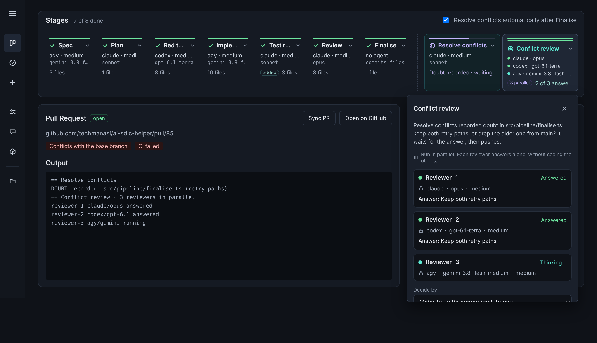
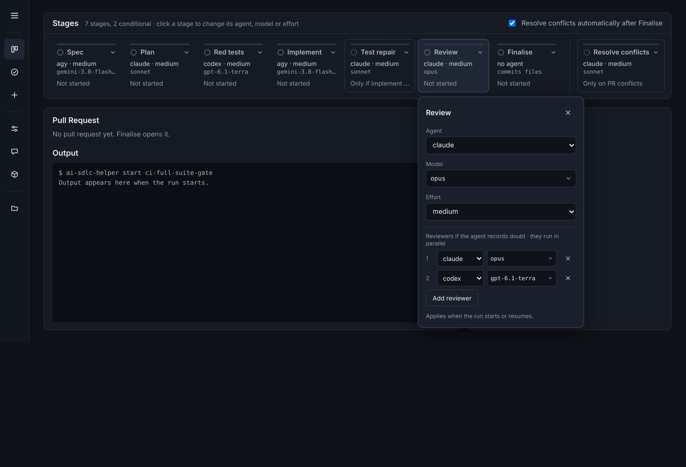

### Searchable model picker

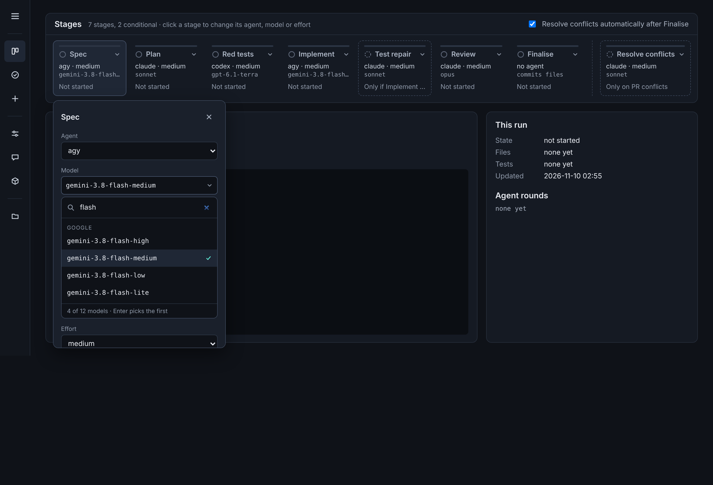

New harnesses bring long model lists. The Model field opens a list with a search box, filtered as you type by
model or provider name, grouped by provider, scoped to the chosen agent. Enter picks the top match, Esc closes.
The footer shows "4 of 12 models". The same picker is used for each reviewer.

### Narrow window

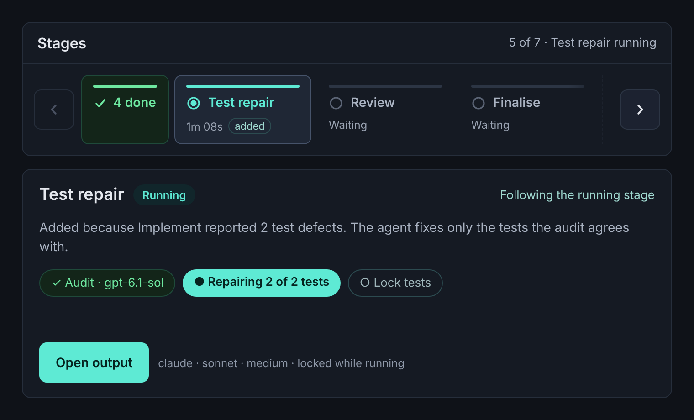

Only when the row cannot fit: finished stages fold into one "✓ N done" tile, then arrow buttons scroll the rest,
with a fade at the cut edge and the running stage scrolled into view. (This board predates the tile and menu
changes above.)

## Failed run: recovery, run override, reviewers, confirmations

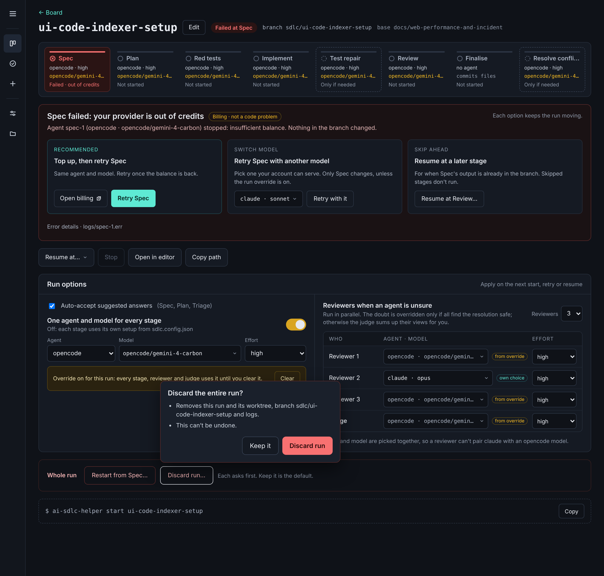

### Error recovery

- The heading names the cause in plain words ("Spec failed: your provider is out of credits") with a category tag
  ("Billing · not a code problem") and what it means for the branch ("Nothing in the branch changed").
- The numbered sentence of options becomes three cards: **Top up, then retry Spec** (recommended: Open billing,
  Retry Spec), **Retry Spec with another model** (model picker, Retry with it), and **Resume at a later stage**
  (Resume at Review…). The raw error folds under "Error details · logs/spec-1.err".
- The failed stage turns red in the stage row.

### Run override

- A switch, "One agent and model for every stage", with agent, model and effort beside it. Off means each stage
  uses its own setup from `sdlc.config.json`.
- While on, one amber line says it applies to every stage, reviewer and judge until cleared, with a Clear button,
  and every stage tile shows the override model in amber.
- Turning it on asks first. Turning it off does not.

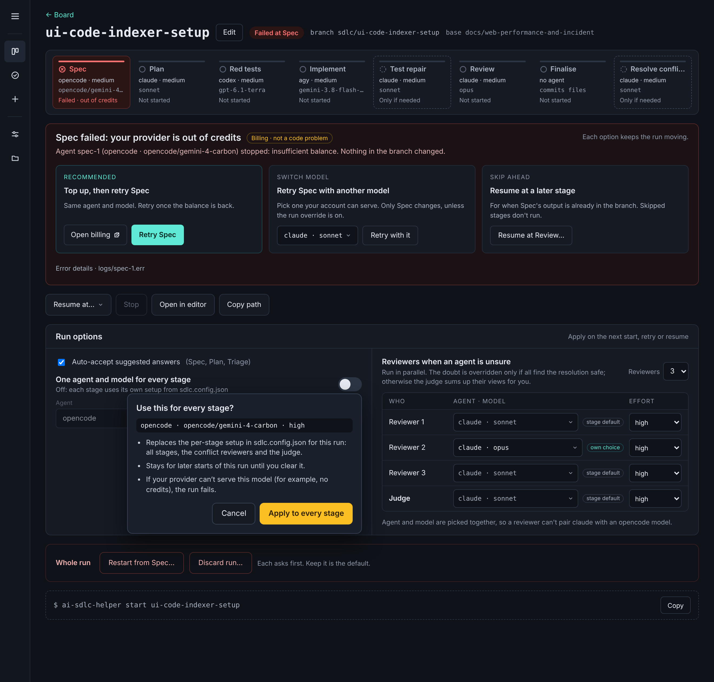

### Reviewers and judge

- A compact table (Reviewer 1–3 and the Judge) replaces the stacked dropdowns: one agent-and-model picker and one
  effort per row. Picking agent and model together prevents mismatches such as a claude agent with an opencode
  model.
- Each row is tagged with where its value comes from: "from override", "stage default" or "own choice".

### Confirmations

- Every action that is hard to undo opens a small popup attached to its button: a title, two or three lines on
  what happens, **Keep it** (or Cancel) and the action. This replaces swapping the button to "Confirm …" plus
  "Keep it".
- Red for Discard run and Restart from Spec; amber for the run override and Resume at Review.

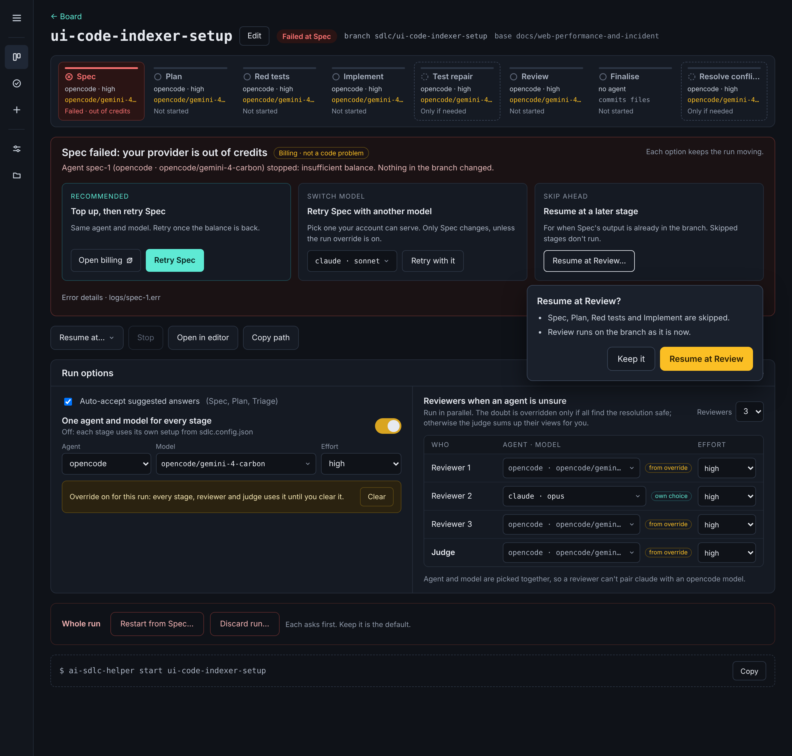

## Other pages

All pages share a left menu that collapses to an icon strip. Icons stay clickable when collapsed; the menu button
opens labels and counts over the page and closes after a pick.

| Board | Completed |
| --- | --- |
| 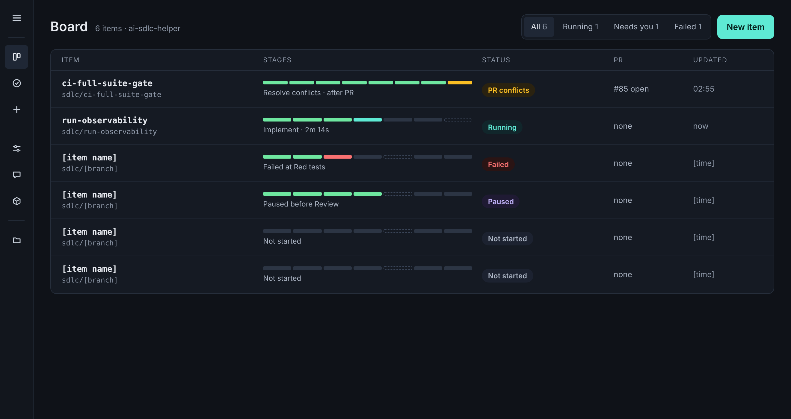 | 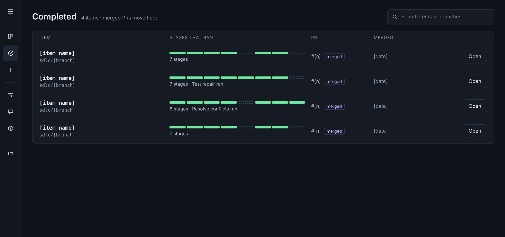 |

| Settings | Projects |
| --- | --- |
| 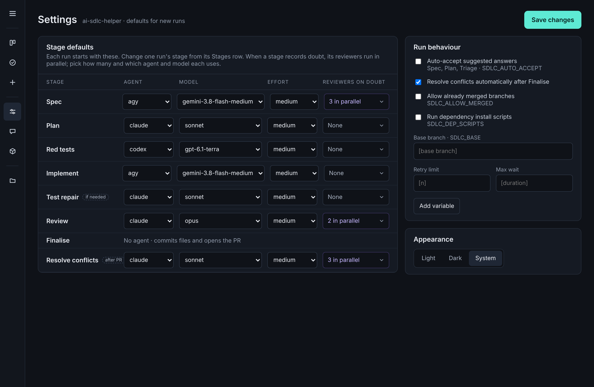 | 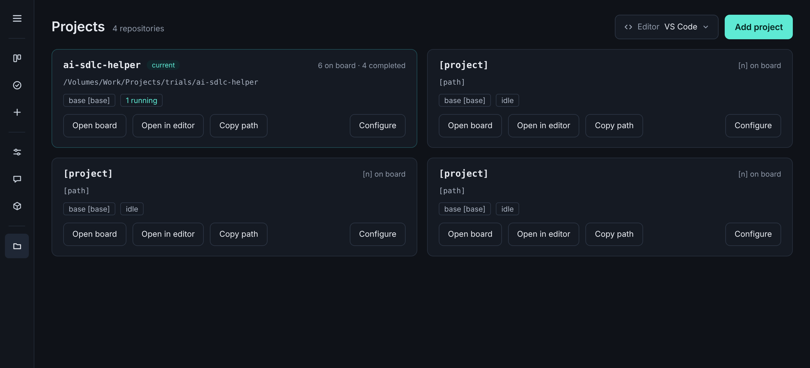 |

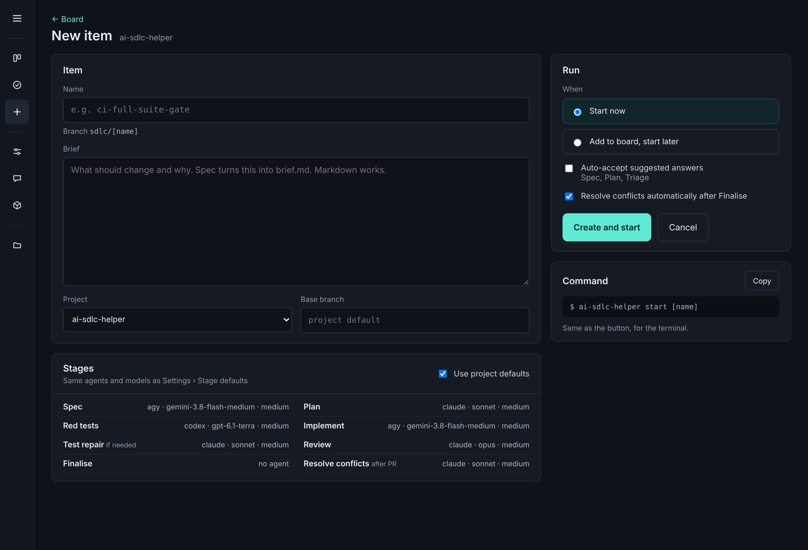

- Board: one row per item with a stage progress strip, current stage, status, PR, last update; filters All,
  Running, Needs you, Failed.
- Completed: merged items with the stages that ran (for example "Test repair ran"), PR and merge date.
- Settings: Stage defaults (agent, model, effort, reviewers on doubt), Run behaviour (`SDLC_*` variables),
  Appearance.
- Projects: one card per repository with path, base branch, counts, Open board, Open in editor, Copy path and
  Configure. An Editor button sets the default editor for Open in editor everywhere: VS Code (`code`), Cursor
  (`cursor`), Zed (`zed`), IntelliJ IDEA (`idea`), System default, or a custom command with `{path}`.
- New item: name (with branch preview), brief, project, base branch; stage settings from project defaults or
  customised; Start now or Add to board; the matching `ai-sdlc-helper start <name>` command.

## What the engine needs

- A doubt event from a stage: the question, the file or topic, and that the stage is waiting.
- Per-stage reviewer config (list of agent, model, effort) and a decision rule; reviewer runs in parallel with
  their own status and answer, and the decision fed back to the waiting stage.
- A per-harness model catalog with provider names, for the model picker.
- A default-editor setting used by every Open in editor.
- A failure category from the agent error (for example billing versus code), so recovery can name the cause and
  recommend an option.
- Where each reviewer's and the judge's agent and model come from (override, stage default, own choice).

## Placeholders and open points

- Bracketed values (`[item name]`, `[date]`, `[base branch]`, Spec's doubt question) are placeholders.
- Confirmation copy for Discard run (what it removes) and Restart from Spec (what it replaces) needs checking
  against the engine.
- Model names beyond those seen in the current UI are filler to show a long list; the real list comes from each
  harness.
- Not yet carried over: the picker in Settings and New item (plain dropdowns), reviewer stages on the Board and
  Completed progress strips, the reviewers column in New item, the top bar, the rest of the run screen (run
  options, command line, environment, files per stage, documents), the narrow board, and the light theme.
