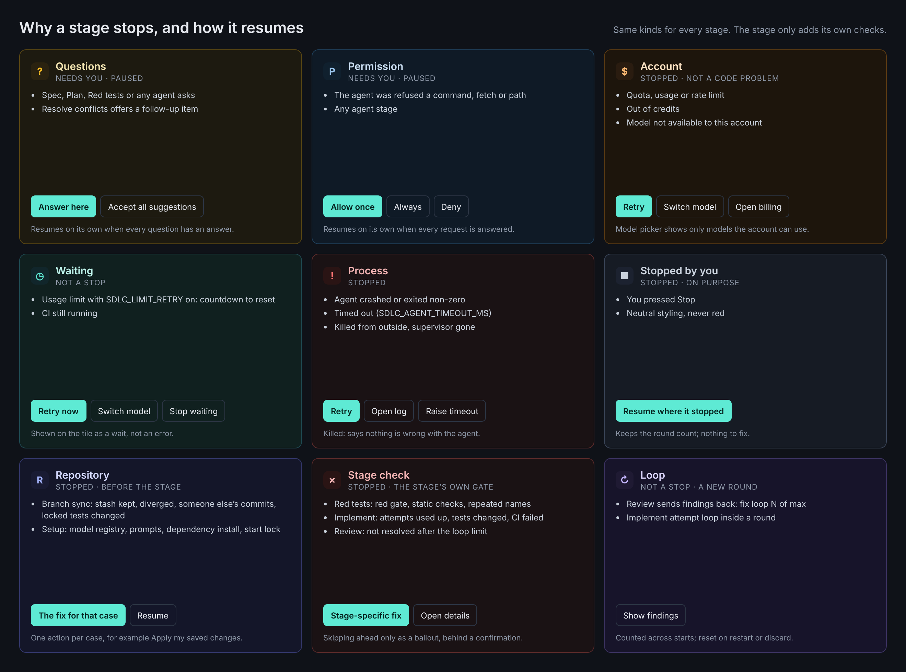
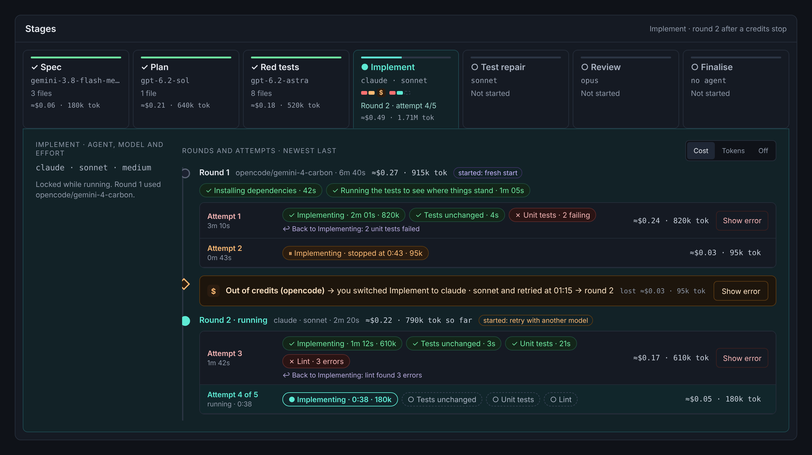
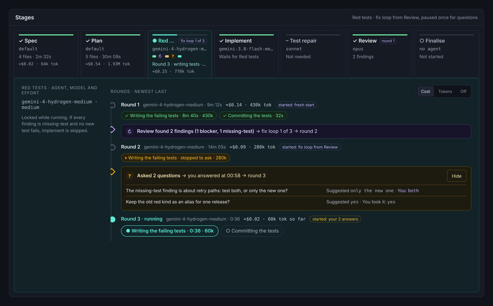
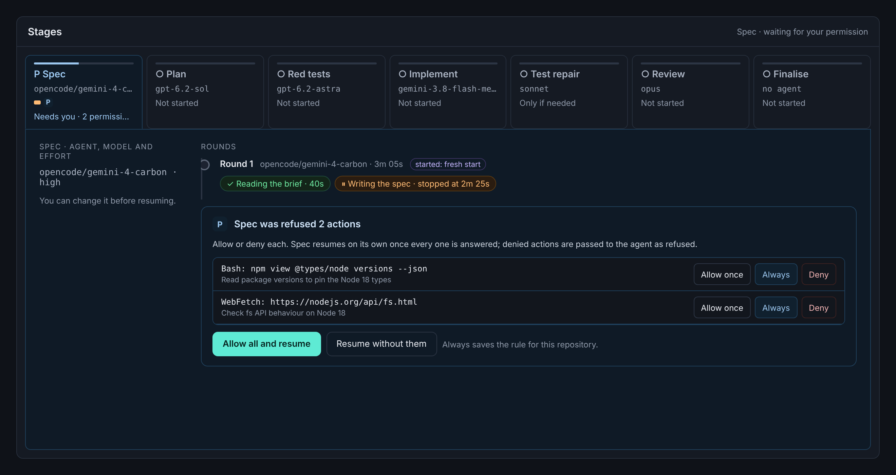
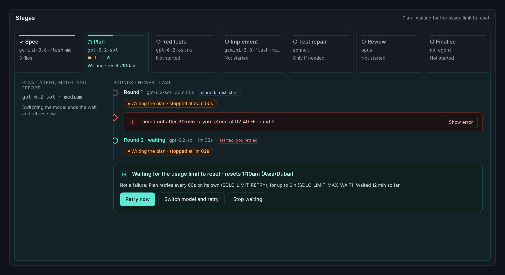
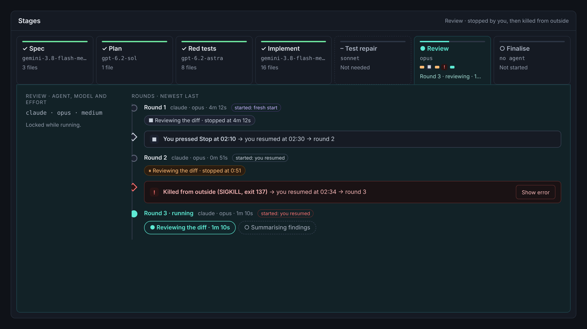

# Stop kinds: why a stage stops, and how it resumes

Part of the [web UI redesign](README.md). Read from `main` at `175c22d` and the task branch
`sdlc/fix-loop-red-gate-kind_2` (spec and plan for the fix-loop red gate).

A run moves through stages; each start of a stage is a **round**; inside Implement each go through the check loop
is an **attempt**. A round ends for one of a small set of reasons, the **stop kinds**. The UI shows the kind the same
way in every stage, and each kind owns its resume actions. Stage-specific behaviour is limited to the stage's own
checks.



## The kinds

| Kind | Mark | Causes | Exit | Resume actions |
| --- | --- | --- | --- | --- |
| Questions | `?` amber | An agent asks (`stages.ts:240, 280, 313`); Resolve conflicts offers a follow-up item (`resolve-conflicts.ts:850, 1013`) | 2 paused | Answer in the page, accept all suggestions; resumes once every question has an answer |
| Permission | `P` blue | The agent was refused actions (`agent.ts:368`) | 2 paused | Allow once, always, deny per request; resumes once every request is answered |
| Account | `$` orange | Quota, usage or rate limit (`agent.ts:24–76, 344, 348`), out of credits, model not available to the account (`hints.ts:255`) | 1 | Retry, switch model (picker limited to models the account serves), open billing |
| Waiting (not a stop) | `◷` teal | Usage limit with `SDLC_LIMIT_RETRY` set (retries until `SDLC_LIMIT_MAX_WAIT`); CI still running | – | Retry now, switch model, stop waiting; shown as a wait with a countdown |
| Process | `!` red | Agent crashed or exited non-zero (`agent.ts:386`), timed out (`SDLC_AGENT_TIMEOUT_MS`, `agent-process.ts:73`), killed by a signal or the supervisor died (`hints.ts`, signalled and orphaned) | 1 | Retry, open the log, raise the timeout; a kill says nothing is wrong with the agent |
| Stopped by you | `■` grey | Stop pressed (`context.ts:134`, "STOPPED: the run was stopped") | – | Resume where it stopped; neutral styling, never red |
| Repository | `R` indigo | Branch sync before every stage (`branch-sync.ts`): stash kept, locked tests changed on GitHub, someone else's commits, detached HEAD, diverged, fast-forward or lease push failed, PR already merged (exit 5). Setup: model registry, prompts, dependency install (`deps.ts`), start lock held (`runs/index.ts:220`), previous stage output missing (`stages.ts:293, 353, 532`) | 1 / 5 | The fix for that case (apply my saved changes, pull and rebase, restart at Implement), then resume |
| Stage check | `✗` | The stage's own gates, listed below | 1 | Stage-specific fix; skipping ahead only as a bailout, behind a confirmation |
| Loop (not a stop) | `↻` purple | Review sends findings back (fix loop N of `review.maxLoops`); Implement's attempt loop inside a round | – | Show findings |

## Stage checks

- **Spec, Plan**: the stage produced nothing (`stages.ts:253`). Plan and Red tests cannot be resumed once the
  red-tests commit exists (refused at start).
- **Red tests**: source files modified (`:389`), no test file (`:395`), static checks on new test files (`:402`),
  every new test passes before Implement (`:416`), repeated test names (`:431`), some new tests already pass
  (`:436`, recovery points to Plan).
  - Task branch: in a fix loop, a test that passes both now and at the red-tests commit is rejected, and a blocker
    finding needs at least one failing test. Recovery is always Resume at Red tests, never Plan, Spec or Implement.
    When every finding is `missing-test` and no new test fails, Implement is skipped (a skipped stage, not a stop).
    Resuming at Red tests restores the round's findings.
- **Implement**: tests still failing after `MAX_ATTEMPTS` (`run.ts:330`), locked tests modified (`:598`), push
  failed (`:624`, paused), CI did not finish (`:725`, paused), CI failed (`:966, 973`), claimed test defects (goes
  to Test repair).
- **Test repair**: repair rejected, claims fail the pre-check (`:756–811`).
- **Review**: Review modified tests, `REVIEW FAILED` (`review-gate.ts:56`), `REVIEW NOT RESOLVED` after
  `maxLoops` (`:243`). Task branch: loops counted across starts from `logs/review-rounds.json`, reset on restart
  from Spec or Plan, or discard.
- **Resolve conflicts**: stopped without pushing, paused on the follow-up question, answered no.
- **Finalise**: push or PR errors, push check failed (`push-check.ts:265`), PR already merged.

## Gaps in today's recovery (`hints.ts`)

1. Questions and permissions have recovery only for Spec; other stages fall through to a generic retry.
2. Stop pressed by the user gets the stage's "exited unexpectedly" text.
3. Quota stops and crashes always offer "Resume at Review" as the bailout, which skips stages from Spec or Plan.
4. Model not supported always suggests `--model gpt-4o`.
5. A timeout reads the same as a crash.
6. Nothing records why a round started or ended. `attempts.jsonl` holds agent rounds, `review-rounds.json` only
   Review.

## Proposal

### 1. Classify every stop into a kind

One classifier for every stage; stage hints only override the Stage check kind. Fixes gaps 1 to 5.

### 2. A round log

`logs/rounds.jsonl`, one line per stage start and one per end:

```json
{"stage":"implement","round":2,"at":"…","startedBy":{"kind":"account","action":"switched model","by":"you"},"model":"claude/sonnet"}
{"stage":"implement","round":2,"at":"…","endedBy":{"kind":"process","detail":"…","log":"logs/impl-4.err"},"attempts":[3,4]}
```

- `startedBy`: fresh start, resume, answered questions, permission granted, retry, retry with another model,
  automatic retry after a limit, fix loop from Review.
- `endedBy`: kind, detail, log file. Questions, answers and permission decisions attach to the round that asked.

### 3. Rounds contain attempts

- The steps area shows a round timeline; each round holds its attempt rows (Implement) or its step pills (other
  stages). Between rounds, one row: what stopped it, what you did, the next round. Q&A, permissions and errors open
  from that row; failed attempts keep their own Show error.
- A stop in the middle of an attempt ends that attempt with the kind's mark.
- The tile has one mark row grouped by round: attempt bars, then the kind's mark at the round boundary. The status
  line keeps both numbers, for example "Round 2 · attempt 4/5".
- Decide whether the attempt count carries across rounds. Implement saves it when the push fails (`saveAttempts`
  near `stages.ts:622`); other stops may not, which is the same class of bug the task branch fixes for the Review
  loop limit.

| Implement | Red tests |
| --- | --- |
|  |  |

| Spec | Plan |
| --- | --- |
|  |  |



### 4. Waits are not stops

A usage-limit wait or a CI wait shows on the tile as a wait with a countdown, with Retry now and Switch model.

### 5. The fix loop is visible

A Red tests round that comes from Review reads "fix loop N of max, from Review". Implement shows as skipped with the
reason when only `missing-test` findings were open.

### 6. Cost and tokens

The data exists: every agent round writes tokens, usage, model and duration to `logs/attempts.jsonl`
(`observeRound` in `agent.ts`). It maps onto steps, attempts and rounds.

- **Tile:** the stage total, as today (`≈$0.49 · 1.71M tok`).
- **Round header:** that round's cost and tokens beside its model and time ("so far" while it runs). Rounds can use
  different models, so this shows where the money went.
- **Attempt row:** cost and tokens in a right-hand column, so it scans down.
- **Steps:** only agent steps (Implementing, Writing the failing tests, Reviewing) carry a short token count
  (`· 820k`). Checks (unit tests, lint, tests unchanged) cost no tokens and keep their time only.
- **Stop rows:** `lost ≈$0.03 · 95k tok` when a stop cut a round short.
- **Reviewers:** a cost per reviewer card and a total on the reviewer tile.
- **Run:** a run total and cost per stage in This run, and an optional budget warning in Settings.
- **Display:** a Cost / Tokens / Off switch. Cost is always shown with `≈`, from a price table per model; when a
  model's price is unknown, tokens only. Details (input, output, cache tokens, model, price used) on hover.
- **Engine check:** Review rounds of a fix loop and reviewer lanes must land in the same log so totals add up;
  `review-rounds.json` is separate today.


## Placeholders

Questions, answers, errors, times and model names in the boards are examples.
